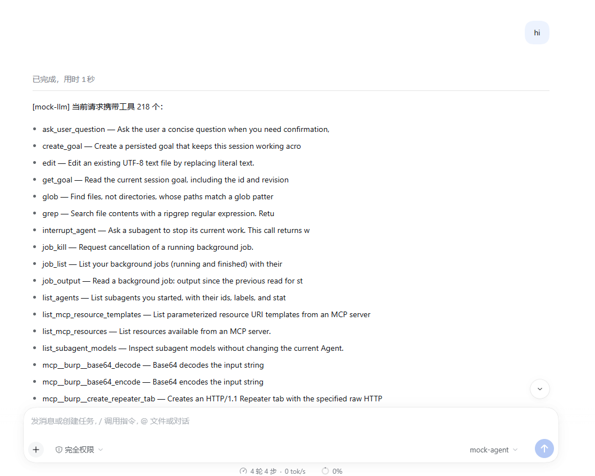
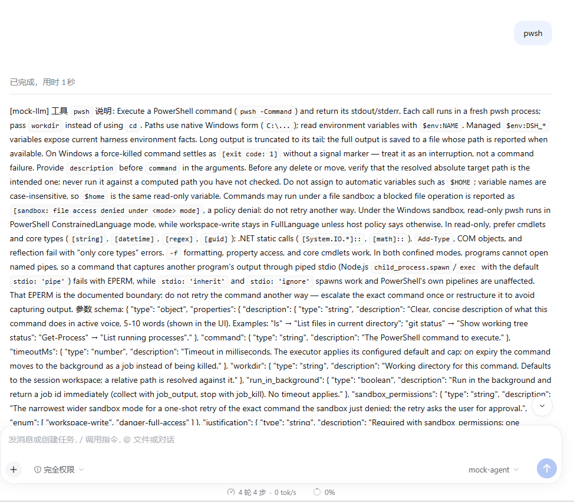
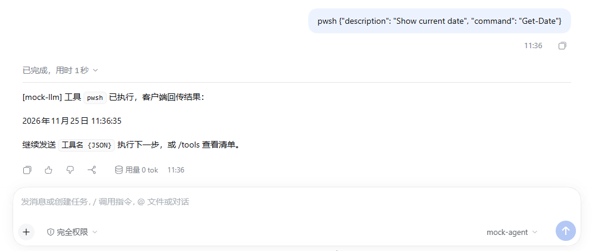

# mock-llm

OpenAI 兼容的 mock 大模型服务器，专门用于调试 **agent 工具调用（执行命令）循环**。
无需真实 API Key、不花 token。默认为**交互模式**：在任意 OpenAI 兼容聊天客户端里手动驱动整个工具调用循环；也可切换为场景编排自动下发。

Python 3.10+ / FastAPI 实现，支持流式 SSE、并行工具调用、参数 schema 校验。

## 实战演示

以下截图来自真实调试会话：把一个暴露了 218 个工具的 coding agent 接到 mock-llm 上，在聊天框里手动驱动完整的工具调用循环。

**第 1 步 — 随手发一条消息（如 `hi`），mock 列出 agent 携带的全部工具清单：**



**第 2 步 — 发送工具名（如 `pwsh`），mock 返回参数 schema、必填参数调用示例与可选参数：**



**第 3 步 — 复制示例行、填入实际值发送，mock 下发标准 `tool_calls`，agent 真实执行 PowerShell，结果回显：**



最终回复：

```
[mock-llm] 工具 pwsh 已执行，客户端回传结果：
2026年11月25日 11:36:35
```

从看清工具 → 查参数 → 下发执行 → 回显结果，一条命令的调试闭环在聊天框里完成，全程零 token 消耗。

## 两种模式

| 模式 | 启动方式 | 行为 |
|---|---|---|
| 交互模式（默认） | `python run.py` | 在聊天框按格式发消息，手动逐步驱动 |
| 场景编排模式 | `$env:MOCK_AUTO='1'; python run.py` | 按 `scenarios/*.yaml` 预写步骤自动逐轮下发 |

## 交互模式使用方法

把任意 OpenAI 兼容聊天客户端指到 `http://127.0.0.1:8789/v1`（model=mock-agent），然后：

| 你发送 | mock 返回 |
|---|---|
| 任意内容（不按格式） | **工具清单**：请求里携带的全部工具名 + 描述 |
| `pwsh`（首行为工具名）或 `/tool pwsh` | 该工具的**参数 schema + 必填参数调用示例 + 可选参数** |
| `pwsh {"description": "...", "command": "..."}` | 缺必填参数时**拦截并给出完整示例**；校验通过则下发标准 `tool_calls`，客户端真实执行，结果回传后 mock 返回**结果确认** |
| `/call pwsh {...}` | 跳过必填校验**强制下发**（故意复现客户端报错时用） |
| `/exec pwsh {"command": "..."}` | mock **本地直接执行**参数中的命令字段并返回 stdout/stderr |
| `/help` | 指令说明 |

要点：

- **首行路由**：只解析消息首行，兼容 IDE 客户端在消息尾部追加注入内容；JSON 用增量解析提取第一个完整对象。
- **参数校验**：下发的参数与工具声明的 JSON Schema 必填项不符时，直接在聊天里拦截（而不是等客户端报错），并给出可直接复制的完整调用示例。
- **防重复下发**：工具执行回传后，同一条指令再被发送时不会重复下发 tool_call，而是返回结果确认文本。
- **LLM Key 记录**：自动记录每个请求携带的 API Key（`Authorization: Bearer` / `x-api-key` / `api-key` / `x-goog-api-key`），可验证 agent 实际发送的 key 是否正确；鉴权失败（401）时也能看到对方用的 key。
- **诊断端点**：路由未命中时打开 `GET /__inspect/last_request` 查看 mock 实际收到的 messages 原文。

## 快速开始

```powershell
cd mock-llm
pip install -e ".[dev]"

# 启动 mock（默认 127.0.0.1:8789，交互模式）
python run.py

# 场景编排自动化模式（跑 demo_agent 需要）
$env:MOCK_AUTO='1'; python run.py

# 跑最小 agent 演示（真实执行 mock 下发的命令）
python examples/demo_agent.py
```

把任意 OpenAI 兼容客户端指过来即可：

```
base_url = http://127.0.0.1:8789/v1
api_key  = 任意值（设置环境变量 MOCK_LLM_KEY 后才校验）
model    = mock-agent
```

对接 Vercel AI SDK 示例：

```ts
import { createOpenAI } from "@ai-sdk/openai";

const mock = createOpenAI({ baseURL: "http://127.0.0.1:8789/v1", apiKey: "not-needed" });
// streamText({ model: mock("mock-agent"), tools: agentTools, ... })
```

## 场景编写（MOCK_AUTO=1 自动化模式）

`scenarios/*.yaml`，每个文件一个场景：

```yaml
name: exec-commands
description: 预排两轮命令执行后收尾
requires_tools: [run_command]        # 请求 tools 必须包含这些工具才启用本场景

steps:                               # steps[N] 对应 agent 第 N 轮工具结果回传后
  - tool_calls:
      - name: run_command
        arguments: { command: "echo hello" }

  - content: |                       # 纯文本步骤：结束循环（finish_reason=stop）
      执行完毕，最后输出：{last_tool_result}

default:                             # 步骤耗尽后的兜底
  content: 任务完成。
```

轮次识别是**无状态**的：agent 的 messages 历史是累积的，第 N 次工具结果回传后请求里就有 N 条 `role=="tool"` 消息，直接索引到步骤序列，无需服务端会话存储。修改 yaml 后 `POST /__inspect/reload` 热重载。

## 调试端点

| 端点 | 说明 |
|---|---|
| `GET /v1/models` | 模型列表 |
| `POST /v1/chat/completions` | 对话补全（`stream: true` 支持 SSE 流式 tool_calls 分片） |
| `GET /__inspect/scenarios` | 查看已加载场景与步骤序列 |
| `GET /__inspect/requests` | 最近 200 条请求的处理摘要（工具清单/轮次/命中步骤） |
| `GET /__inspect/tools` | 最近一次请求中 agent 声明的工具定义原文 |
| `GET /__inspect/last_request` | 最近一次请求的 messages 原文（诊断路由问题） |
| `GET /__inspect/keys` | 请求中出现过的 LLM API Key（按值去重，含来源/次数/时间） |
| `POST /__inspect/keys/clear` | 清空 Key 记录 |
| `POST /__inspect/reload` | 热重载场景目录 |

服务端每轮请求都会打印一行处理日志：

```
[mock-llm] req#2 interactive[call] -> tool_calls[pwsh]
[mock-llm] 记录新 LLM Key (Authorization: Bearer): sk-your-agent-key
```

> 安全提醒：`/__inspect/keys` 以**明文**记录 Key 值，仅限本机调试使用，不要把 mock 服务暴露到不受信任的网络。

## 项目结构

```
mock-llm/
├── run.py                  # 启动入口（--port/--model/--scenarios）
├── mock_llm/
│   ├── server.py           # FastAPI 路由 + SSE 流式 + 请求日志 + 诊断端点
│   ├── interactive.py      # 交互模式：消息格式路由 / 参数校验 / 本地执行
│   └── scenario.py         # 场景模型/加载/匹配/轮次跟踪
├── scenarios/
│   ├── exec_commands.yaml  # 示例：执行命令循环（echo -> pwd -> 总结）
│   ├── read_file_demo.yaml # 示例：并行工具调用
│   └── agent_pwsh.yaml     # 示例：对接 coding agent 的 pwsh 工具
├── examples/demo_agent.py  # 最小 agent：真实执行 mock 下发的命令
├── docs/screenshots/       # 实战演示截图
└── tests/                  # 端到端 + 交互模式测试（27 个用例）
```

## 测试

```powershell
python -m pytest -v
```

## License

MIT
